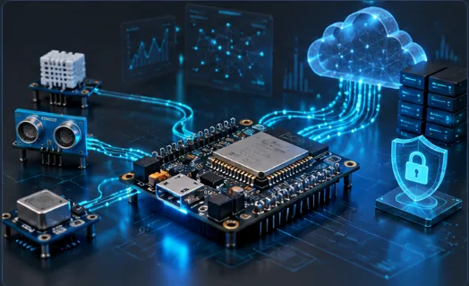

# Hi, I'm W. A. Buddhika Sankalpa 👋

**Software meets the physical world. Ideas become useful things.**

  
  
  
  

---

## A little about me

I'm an **Electronics & Computer Science undergraduate at the University of Kelaniya**, with an expected graduation year of **2028**.

I build full-stack web applications and explore electronics, embedded systems, and machine learning. I'm especially interested in work that connects software with real-world devices. I'm also learning more about **IoT, DevOps, MLOps, cloud, and cybersecurity**.

- 💻 Building web applications and practical digital tools
- 🔌 Exploring connected devices and embedded systems
- ☁️ Practising with AWS and cloud infrastructure
- 🤝 Coordinating technical and creative work through university events

## Technologies I work with

I use these languages and tools to build web applications, explore intelligent systems, and work with electronics.

### 💻 Programming languages

### 🌐 Frontend & web

### ⚙️ Backend & databases

### ☁️ Cloud & development tools

### 🔌 Electronics & machine learning

### 🎨 Design & creative tools

## Selected projects

> **01 / [NEVERMORE Boarding](https://rentpay-web-frontend.vercel.app/)**  
> A web platform for boarding and property management.

> **02 / [I-Computers](https://i-computers-frontend-five.vercel.app/)**  
> A full-stack e-commerce platform for online shopping.

> **03 / [E-learning Platform](https://learnbridge-edulk.vercel.app/)**  
> A full-stack platform for digital education.

> **04 / [Security Service Management System](https://nexgard-pi.vercel.app/)**  
> A web-based system for a security service providing company.

> **05 / [Movie & TV Series Recommendation System](https://frame-umber-one.vercel.app/)**  
> A platform for discovering movie and TV series suggestions.

## Beyond the code

I enjoy contributing to university events through technical coordination, communication, logistics, and creative work.

| Event / organization | My contribution |
| :--- | :--- |
| **AWS Student Community Day Sri Lanka 2026** | Head of Event & Logistics; recognized for outstanding contribution. |
| **UOK Robot Battle** | Technical Coordinator (2025) and Co-Technical Coordinator (2024). |
| **MEDUSA** | Technical Coordinator (2026) and Video Editing Head (2025). |
| **Electronics and Computer Science Club** | Public Relations Coordinator, Technical Coordinator, and Designing Team Member. |

> **Creative work** 🎬  
> I have also edited videos for different events and functions.  
> [View selected video edits ↗](https://drive.google.com/drive/folders/137IXd5UaJ8qCyT4dNUFwO2Qj4ew0LcPU)

<!-- ------------------------------------ -->
<!-- GITHUB — BEHIND THE COMMITS           -->
<!-- ------------------------------------ -->

<h2 align="center">Behind the commits</h2>

  Building, experimenting, and learning through code.
   
  A snapshot of my GitHub activity and the languages behind my projects.

  

  
  
  

  Small experiments. Practical projects. Continuous learning.
    
  <a href="https://github.com/BuddhikaSankalpa?tab=repositories"><strong>Explore my repositories</strong></a>

<!-- ------------------------------------ -->
<!-- END OF GITHUB SECTION                -->
<!-- ------------------------------------ -->

## Education

**University of Kelaniya**  
Electronics & Computer Science undergraduate · Expected graduation: **2028**

**Dharmapala College, Pannipitiya**  
GCE Advanced Level, Physical Science

---

### Let's connect

[Email me](mailto:buddhikasankalpa304@gmail.com) ·
[LinkedIn](https://www.linkedin.com/in/buddhika-sankalpa-542a04311/) ·
[WhatsApp](https://wa.me/94717309230)

Curious mind. Ideas made real.

